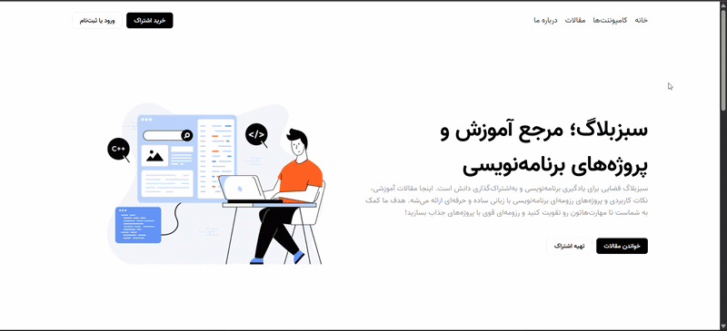

# SabzBlog — React Blog UI



A Persian blog landing page built with React to refresh my React skills and practice component-based UI development.

## ✨ Overview

SabzBlog is a Persian, right-to-left (RTL) blog interface focused on programming education and learning resources. It features a hero section, a grid of article cards, and a call-to-action footer.

## 🚀 Features

- Persian RTL layout with custom Vazir fonts.
- Reusable React components.
- Dynamic article rendering using JavaScript arrays and props.
- Article cards with author information, publication dates, and pricing.
- Custom styling with CSS, Flexbox, and CSS Grid.

## 🛠️ Built With

- React
- JavaScript (ES6+)
- HTML5
- CSS3

## 📚 Learning Resources & Credits

This project was developed as part of my React learning journey, with guidance from the tutorials provided by [SabzLearn](https://sabzlearn.ir/).

The project is intended for learning and practicing React development.

## ⚙️ Getting Started

### Prerequisites

- [Node.js](https://nodejs.org/)
- npm

### Installation

1. Clone the repository:

   ```bash
   git clone <YOUR_REPOSITORY_URL>
   ```

2. Navigate to the project directory:

   ```bash
   cd <YOUR_PROJECT_DIRECTORY>
   ```

3. Install dependencies:

   ```bash
   npm install
   ```

4. Start the development server:

   ```bash
   npm run dev
   ```

## 🎯 Learning Goals

- Refresh React fundamentals.
- Practice component composition and props.
- Improve code organization and styling.
- Gain hands-on experience building a frontend project.

## 🔮 Future Improvements

- Add responsive layouts for mobile and tablet screens.
- Implement article detail pages.
- Add functional navigation and interactive features.
- Connect the application to a data source.

## 📄 License

Created for learning and personal practice.
